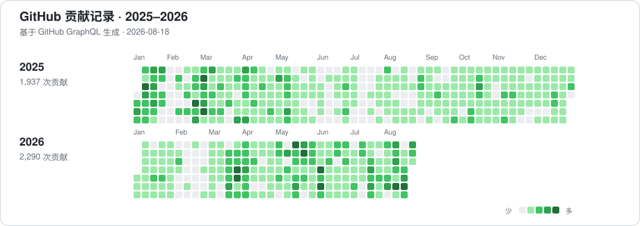

# 张文杰（Wenjie Zhang）

### 江南大学 · 软件工程博士研究生

**AI Agent · 知识图谱 · 大模型应用**

我的研究与实践聚焦于 **AI Agent、知识图谱与大模型应用**，重点关注 Agent Harness、Agentic RAG、GraphRAG、MCP/Skills、智能体评测与知识图谱问答，致力于让智能体更好地利用知识、工具与运行轨迹完成复杂任务。

已发表或参与论文十余篇，第一作者工作获 **ECML-PKDD Oral**、**ACML Oral**。同时持续推进研究成果的工程落地，具备从算法研究、系统架构到开源项目建设的完整实践经验。

预计于 **2027 年 12 月毕业**，现寻求 **AI Agent、Agentic RAG、知识图谱与大模型应用**方向的实习或全职机会。

📮 **联系邮箱：** [wenjie.zhang@stu.jiangnan.edu.cn](mailto:wenjie.zhang@stu.jiangnan.edu.cn)

  
  

我是 **[Yuxi](https://github.com/xerrors/Yuxi)** 的发起者与核心维护者，从 0 到 1 完成了整体架构和核心功能建设。Yuxi 是一个可私有部署的多租户知识智能体平台，将 RAG、知识图谱、多智能体、MCP/Skills、沙盒工具与权限管理整合在统一工作台中。

项目目前拥有 **7700+ Stars** 和 **1100+ Forks**，衍生版本已在多家企业实际使用。更多信息请访问：[项目主页](https://github.com/xerrors/Yuxi) · [在线文档](https://xerrors.github.io/Yuxi/) · [快速开始](https://xerrors.github.io/Yuxi/intro/quick-start)

<picture>
  <source media="(prefers-color-scheme: dark)" srcset="./assets/contributions-dark.svg" />
  <source media="(prefers-color-scheme: light)" srcset="./assets/contributions-light.svg" />
  
</picture>
贡献图基于 GitHub GraphQL 数据生成，2026 年为截至当前的年度数据。
